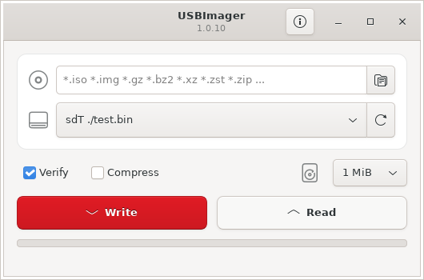

<p align="center"></p>

<h1 align="center">ImageUploader</h1>

<p align="center">
  Flash disk images to USB drives and SD cards, and create backups.<br>
  Tiny, fast, open source, with a clean modern interface.
</p>

<p align="center">
  <a href="https://parsamajidi21.github.io/ImageUploader/">Website</a> ·
  <a href="#building">Build</a> ·
  <a href="#usage">Usage</a> ·
  <a href="LICENSE">MIT License</a>
</p>

<p align="center">
  
</p>

## Features

- **Compressed images on the fly:** `.gz`, `.bz2`, `.xz`, `.zst`, plus `.zip` (incl. ZIP64), `.zzz`, `.tar`, `.cpio` and `.pax` archives. No need to extract first.
- **Raw images:** `.iso`, `.img`, `.bin`, `.raw`, `.dd` and the like.
- **Verified, synchronized writes:** every block can be read back and compared, and all data is physically on the drive when the progress bar reaches 100%.
- **Hard to make a mistake:** the system disk is kept out of the target list.
- **Backups:** read a drive back to a raw image, or a ZStandard-compressed one.
- **Serial line:** send images to microcontrollers and embedded boards.
- **Modern GTK interface:** header bar, drag and drop, and it follows your light or dark theme.
- **18 languages**, detected from your system.
- **Small, no dependencies:** every parser and decompressor is built in. No telemetry, no ads.

## Download

Version 1.0.0:

| Package | Notes |
|---------|-------|
| [imageuploader_1.0.0-x86_64-win-gdi.zip](https://github.com/parsamajidi21/ImageUploader/releases/download/v1.0.0/imageuploader_1.0.0-x86_64-win-gdi.zip) | **Windows** 10/11 64-bit. Extract and run `imageuploader.exe` |
| [imageuploader_1.0.0_wo-x86_64-win-gdi.zip](https://github.com/parsamajidi21/ImageUploader/releases/download/v1.0.0/imageuploader_1.0.0_wo-x86_64-win-gdi.zip) | Windows, simplified write-only interface |
| [imageuploader_1.0.0-arm-macosx-cocoa.zip](https://github.com/parsamajidi21/ImageUploader/releases/download/v1.0.0/imageuploader_1.0.0-arm-macosx-cocoa.zip) | **macOS** on Apple silicon, macOS 11+ |
| [imageuploader_1.0.0-intel-macosx-cocoa.zip](https://github.com/parsamajidi21/ImageUploader/releases/download/v1.0.0/imageuploader_1.0.0-intel-macosx-cocoa.zip) | macOS on Intel Macs, macOS 10.13+ |
| [imageuploader_1.0.0-amd64.deb](https://github.com/parsamajidi21/ImageUploader/releases/download/v1.0.0/imageuploader_1.0.0-amd64.deb) | **Linux** GTK, recommended for Ubuntu 22.04 / Debian 12 or newer. Install with `sudo apt install ./imageuploader_1.0.0-amd64.deb` |
| [imageuploader_1.0.0-x86_64-linux-gtk.zip](https://github.com/parsamajidi21/ImageUploader/releases/download/v1.0.0/imageuploader_1.0.0-x86_64-linux-gtk.zip) | GTK, portable, needs udisks2 |
| [imageuploader_1.0.0-x86_64-linux-x11.zip](https://github.com/parsamajidi21/ImageUploader/releases/download/v1.0.0/imageuploader_1.0.0-x86_64-linux-x11.zip) | X11, portable, minimal dependencies |
| [imageuploader_1.0.0_uf-x86_64-linux-x11.zip](https://github.com/parsamajidi21/ImageUploader/releases/download/v1.0.0/imageuploader_1.0.0_uf-x86_64-linux-x11.zip) | X11 with an embedded font, for systems without Unicode X11 fonts |

Linux packages are x86_64. Checksums are on the [release page](https://github.com/parsamajidi21/ImageUploader/releases/tag/v1.0.0).

The Windows and macOS apps aren't code-signed yet. On Windows, if SmartScreen warns, choose *More info* → *Run anyway*. On macOS, after moving the app to Applications, run `xattr -cr /Applications/ImageUploader.app` once, otherwise macOS reports it as damaged.

## Building

You need a C compiler and `make`.

### Linux, modern GTK interface (recommended)

```sh
# Debian / Ubuntu
sudo apt install build-essential libgtk-3-dev
# optional: lets non-root users write to drives through udisks2
sudo apt install libudisks2-dev

git clone https://github.com/parsamajidi21/ImageUploader.git
cd ImageUploader/src
USE_GTK=1 make
./imageuploader
```

Without udisks2 the binary is installed setgid `disk` instead, so your user needs to be allowed to grant that (see [Permissions](#permissions)).

### Other interfaces and targets

| Command               | Result                                            |
|-----------------------|---------------------------------------------------|
| `make`                | Native default: X11 on Linux, GDI on Windows (MinGW), Cocoa on macOS |
| `USE_GTK=1 make`      | GTK 3 interface (Linux)                           |
| `USE_TUI=1 make`      | Text interface                                    |
| `USE_WRONLY=1 make`   | Simplified, write-only interface                  |
| `USE_UNIFONT=1 make`  | X11 with an embedded font                         |
| `make install`        | Install under `/usr`                              |
| `make package`        | Portable zip                                      |
| `make deb`            | Debian package                                    |
| `make help`           | List every option                                 |

Options can be combined, for example `USE_WRONLY=1 USE_GTK=1 make clean all deb`.

## Usage

### Writing an image to a drive

1. Pick an image: click the folder button, type a path, or drag a file onto the window.
2. Pick the target drive. Plugged it in just now? Click the refresh button.
3. Click **Write**.

The format and compression are detected automatically. With **Verify** on, every block is read back and compared to the image. The buffer size selector sets the chunk size; actual memory use is three times that (compressed, uncompressed and verify buffers).

### Creating a backup

1. Pick the drive.
2. Click **Read**.

The image is saved to your Desktop (or Downloads, or your home directory) as `imageuploader-(date)T(time).dd`. With **Compress** on, it's ZStandard-compressed and gets a `.zst` suffix. Pass a directory on the command line to save backups there instead.

### Permissions

- **Linux:** with udisks2 nothing is needed. Otherwise the binary needs the setgid `disk` bit (`sudo chgrp disk imageuploader && sudo chmod g+s imageuploader`), or add your user to the `disk` group. Running it with `sudo` shouldn't be necessary.
- **Windows:** right-click `imageuploader.exe` and choose *Run as administrator*.
- **macOS:** the app re-launches itself with `sudo`. If Finder says the app is damaged, remove the quarantine flag with `xattr -crv /Applications/ImageUploader.app`.

If your drive isn't listed, it may be bigger than the size limit (256 GiB by default, change it with `-m`) or it may be the system disk.

### Command-line flags

| Flag                  | Description |
|-----------------------|-------------|
| `-v`, `-vv`           | Verbose output (prints the SHA-256 checksum and average speed at the end) |
| `-Lxx`                | Force a language, e.g. `-Lde`, `-Lfr` |
| `-0` … `-9`           | Buffer size as a power of two MiB (`0` = 1 MiB … `9` = 512 MiB) |
| `-m(gb)`              | Maximum disk size to list, in GiB |
| `-a`                  | List all devices, **including system disks** — be careful |
| `-f`                  | Force write: always write, even blocks that already match |
| `-s[baud]`, `-S[baud]`| Allow serial ports as targets (`-S` adds a raspbootin handshake) |
| `-F(xlfd)`            | X11 font to use |
| `--version`           | Print the version |
| *(directory)*         | The first non-flag argument is the backup directory |

Flags can be given separately (`imageuploader -v -s -2`) or together (`imageuploader -2vs`).

By default each block is read first and only written if it differs, which is easy on slow or wear-sensitive media. `-f` skips that comparison.

### Serial transfers

With `-s`, images are sent as-is (not decompressed) over the serial line at 115200 baud, 8N1 by default. The client should wait for the first byte, then read with a short timeout (250–500 ms); when the timeout hits, the image is complete.

With `-S`, a [raspbootin](https://github.com/bztsrc/raspi3-tutorial/tree/master/14_raspbootin64) handshake is used:

1. The client sends `\003\003\003` (Ctrl+C three times).
2. ImageUploader sends the image size as 4 bytes, little-endian.
3. The client answers `OK` or `SE` (size error).
4. On `OK`, the image is sent.

Your user needs to be in the `dialout` or `uucp` group (depends on the distribution).

## Credits

ImageUploader is based on [USBImager](https://gitlab.com/bztsrc/usbimager) by bzt, released under the MIT license.

It also includes zlib (Mark Adler), bzip2 (Julian R. Seward), xz (Igor Pavlov and Lasse Collin), zstd (Meta) and libui (Pietro Gagliardi).

## License

MIT. See [LICENSE](LICENSE).
